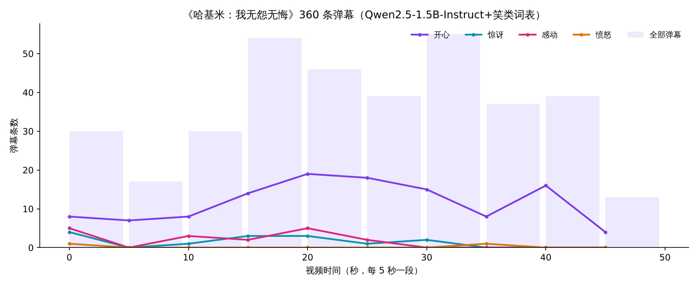
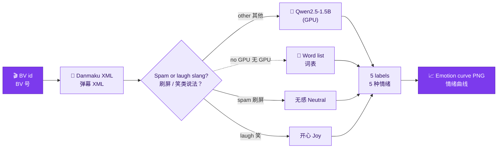

<div align="center">

<picture>
  <source media="(prefers-color-scheme: dark)" srcset="docs/banner-dark.svg">
  
</picture>

**💬 → 📈 Turn one Bilibili video's danmaku into a time-aligned emotion curve.**<br>
**💬 → 📈 把一个 B 站视频的弹幕标成 5 种情绪，按视频时间画成情绪曲线。**


🌍 [English](#-english) · 🌏 [简体中文](#-简体中文)

</div>



<sub>Example: a 46-second meme remix (BV1JjZsYHEHE, 360 comments), 5-second bins, laugh rules + Qwen2.5-1.5B. Purple bars are total comments per bin.<br>示例：鬼畜《哈基米：我无怨无悔》（BV1JjZsYHEHE，46 秒，360 条弹幕），每 5 秒一段，笑类规则 + Qwen2.5-1.5B 标注。浅紫色柱是每段弹幕总数。</sub>



**🏷️ Labels / 标签**


---

## 🌍 English

### 🚀 Quick start

**☁️ Colab (recommended, nothing to install)**

1. Download `DanmakuCurve.ipynb` and open it in [Google Colab](https://colab.research.google.com/) via **File → Upload notebook**.
2. **Runtime → Change runtime type → T4 GPU**.
3. Paste a video link in cell ①, then **Run all**. The curve shows at the bottom; the PNG and CSV download automatically.

Without a GPU it falls back to the word list. If fetching fails, you can upload a danmaku XML file.

**💻 Local**

```bash
python3 -m venv .venv && .venv/bin/pip install -r requirements.txt
.venv/bin/python run.py --xml data/sample_BV1614y197xJ.xml
.venv/bin/python run.py --url https://www.bilibili.com/video/BV1JjZsYHEHE --bin 5
```

This writes `output/curve.png` and `output/labels.csv` (one row per comment). Options: `--bin` seconds per bin, `--title` chart title.

`run.py` uses the word list only (no GPU needed). To label with Qwen locally:

```bash
.venv/bin/pip install torch transformers
```

```python
from danmaku import parse_xml
from llm_label import LLMLabeler, label_all_llm
from curve import plot

rows = parse_xml(open("data/sample_BV1JjZsYHEHE.xml", encoding="utf-8").read())
labeled = label_all_llm(rows, LLMLabeler())  # Qwen/Qwen2.5-1.5B-Instruct
plot(labeled, "curve.png", bin_sec=5)
```

🧪 Tests (offline): `.venv/bin/pip install pytest && .venv/bin/python -m pytest tests`

### 🏷️ Five labels

| Label | Examples |
|---|---|
| 🟣 **Joy** 开心 | 哈哈哈, 笑死, 没绷住, 可爱, memes |
| 🔵 **Surprise** 惊讶 | 卧槽, 居然, 离谱; also praise (牛, 厉害) |
| 🩷 **Moved** 感动 | 泪目, 破防, 暖心, 谢谢 |
| 🟠 **Anger** 愤怒 | 恶心, 退钱, scolding |
| ⚪ **Neutral** 无感 | statements, questions, template spam (正在看), ads |

### ⚙️ How it works

1. **Fetch**: the public Bilibili endpoint by BV id, no login (`danmaku.py`).
2. **Rules first**: spam and ads → Neutral; laugh slang (没绷住, 难绷, 笑死, 2333, hhh…) → Joy, before any model (`SPAM`, `LAUGH` in `label.py`).
3. **Qwen2.5-1.5B-Instruct** (Apache 2.0) labels the rest. It only compares the probability of each label's first token, so the output is always one of the five (`llm_label.py`).
4. **Word-list fallback** without a GPU: danmaku slang rules plus the [cnsenti](https://github.com/thunderhit/cnsenti) emotion lexicon (乐 / 怒 / 惧 only).
5. **Plot**: count per time bin, one line per emotion (`curve.py`).

Optional: the notebook can call any OpenAI-compatible API. The key lives in Colab Secrets, never in code.

### ⚠️ Known limitations

- Sarcasm and context-dependent lines get mislabeled. "就没偷摸骂我两句吧" (a joke: "didn't you secretly curse me?") → Anger; "听了十遍还在听" ("listened ten times and still going") → Neutral.
- There is no "admiration" class, so praise counts as Surprise.
- The rules were tuned on three sample videos; other genres will be less accurate.
- The public endpoint returns only about 1,000–1,200 comments per video (not all of them), first part only.
- Some networks can't reach Bilibili. Save the XML and use `--xml`.
- Not yet: emotion-contagion stats, multi-video comparison, web UI.

### 🎯 Scope

Please use it only on non-political videos (entertainment, daily life, animals, memes). This project does not analyze political content.

### 🗂️ Sample data

`data/` holds danmaku from three public videos, time and text only, no user IDs. A few real spam ads are kept to test filtering. Uploaders can ask for removal via an issue.

---

## 🌏 简体中文

### 🚀 快速开始

**☁️ Colab（推荐，不用装东西）**

1. 下载 `DanmakuCurve.ipynb`，在 [Google Colab](https://colab.research.google.com/) 里 **文件 → 上传笔记本**。
2. **代码执行程序 → 更改运行时类型 → T4 GPU**。
3. 在 ① 里填视频链接，然后 **全部运行**。图显示在最下面，PNG 和 CSV 会自动下载。

没有 GPU 时自动改用词表；抓不到弹幕时可以上传弹幕 XML。

**💻 本地**

```bash
python3 -m venv .venv && .venv/bin/pip install -r requirements.txt
.venv/bin/python run.py --xml data/sample_BV1614y197xJ.xml
.venv/bin/python run.py --url https://www.bilibili.com/video/BV1JjZsYHEHE --bin 5
```

输出 `output/curve.png`（曲线）和 `output/labels.csv`（每条弹幕 + 情绪）。可选参数：`--bin` 每段秒数，`--title` 图标题。

`run.py` 只用词表，不需要 GPU。本地想用 Qwen 标注：先 `pip install torch transformers`，再用上面英文部分的 Python 代码。

🧪 测试（不联网）：`.venv/bin/pip install pytest && .venv/bin/python -m pytest tests`

### 🏷️ 5 种标签

| 标签 | 例子 |
|---|---|
| 🟣 **开心** | 哈哈哈、笑死、没绷住、可爱、玩梗 |
| 🔵 **惊讶** | 卧槽、居然、离谱；也包括夸人（牛、厉害） |
| 🩷 **感动** | 泪目、破防、暖心、谢谢 |
| 🟠 **愤怒** | 恶心、退钱、数落、骂人 |
| ⚪ **无感** | 陈述、提问、刷屏（正在看、弹幕飞过）、广告 |

### ⚙️ 方法

1. **抓弹幕**：用 B 站公开接口按 BV 号取弹幕 XML，不登录（`danmaku.py`）。
2. **规则优先**：刷屏和广告直接判无感；笑类说法（没绷住、难绷、笑死、2333、hhh…）直接判开心，不交给模型（`label.py` 的 `SPAM`、`LAUGH`）。
3. **Qwen2.5-1.5B-Instruct**（Apache 2.0）标其余弹幕。只比较 5 个标签第一个字的概率，所以输出一定是 5 类之一（`llm_label.py`）。
4. **词表兜底**：没有 GPU 时用弹幕黑话词表 + 开源中文情绪词典 [cnsenti](https://github.com/thunderhit/cnsenti)（只用 乐 / 怒 / 惧）。
5. **画图**：按视频时间分段计数，每种情绪一条线（`curve.py`）。

可选：笔记本里也能用 OpenAI 兼容接口标注，key 放在 Colab Secrets，不写进代码。

### ⚠️ 已知局限

- 反讽和要看上下文的句子会错。例如“就没偷摸骂我两句吧”被标成**愤怒**（其实是玩笑），“听了十遍还在听”被标成**无感**（其实是喜欢）。
- 5 类里没有“佩服”，夸人算惊讶。
- 词表是对着 3 个样例视频调的，换类型的视频准确率会低一些。
- 公开接口每个视频只返回一千多条弹幕（不是全部），只取第 1 P。
- 有些网络连不上 B 站，`--url` 会失败，可以先存 XML 再用 `--xml`。
- 还没做：情绪传染统计、多视频对比、网页界面。

### 🎯 使用范围

请只用于**不涉及政治**的视频（娱乐、生活、动物、鬼畜等）。本项目不分析政治内容。

### 🗂️ 样例数据

`data/` 里是 3 个公开视频的弹幕，只保留时间和文本，没有用户 ID。其中有少量真实的刷屏广告，用来测试过滤。如果你是视频作者、希望删除，请开 issue。

- 🐱 `sample_BV1614y197xJ.xml`：《我花了半年时间给猫做了个房子》，1,200 条
- 🎵 `sample_BV1JjZsYHEHE.xml`：《哈基米：我无怨无悔》，360 条
- 🦌 `sample_BV1YNZvYzELw.xml`：《Day97 | 在山上放一盆水，让动物们喝上水。》，332 条

---

## 📁 Files / 文件

| File 文件 | Purpose 用途 |
|---|---|
| `danmaku.py` | fetch and parse · 抓弹幕 + 解析 XML |
| `label.py` | rules and word list · 规则和词表 |
| `llm_label.py` | Qwen or API labeling · Qwen 或 API 标注 |
| `curve.py` | binning and plotting · 分段计数 + 画图 |
| `run.py` | CLI · 命令行入口 |
| `DanmakuCurve.ipynb` | Colab notebook · Colab 笔记本 |
| `make_notebook.py` | rebuild the notebook after code changes · 改完代码后重新生成笔记本 |

## 📜 License

[MIT](LICENSE)
